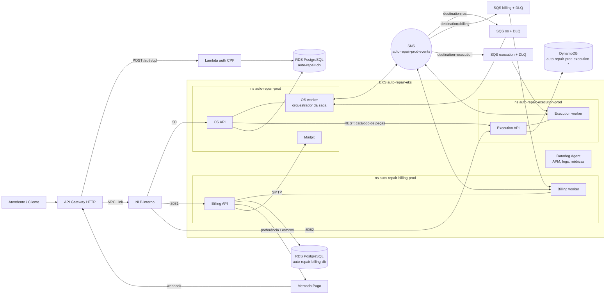

# Arquitetura de microsserviços (Fase 4)

Simplificação: o diagrama liga o SNS aos workers, mas o publish é feito pelo relay do outbox de cada serviço.

## Serviços

| | OS Service | Billing | Execution |
|---|---|---|---|
| Repositório | [auto-repair-api](https://github.com/IgorSantosXP/auto-repair-api) | [auto-repair-billing-service](https://github.com/IgorSantosXP/auto-repair-billing-service) | [auto-repair-execution-service](https://github.com/IgorSantosXP/auto-repair-execution-service) |
| Papel na saga | Orquestrador | Participante | Participante |
| Banco | PostgreSQL (RDS da fase 3) | PostgreSQL (RDS próprio) | DynamoDB |
| Rotas no API Gateway | `ANY /api/{proxy+}` (todo `/api` que não é dos outros serviços) | `/api/v1/budgets/*`, `/api/v1/payments/*`, `POST /webhooks/mercadopago` | `/api/v1/parts/*`, `/api/v1/executions/*` |
| Namespace (prod / homolog) | `auto-repair-prod` / `auto-repair-homolog` | `auto-repair-billing-prod` / `-homolog` | `auto-repair-execution-prod` / `-homolog` |
| Infra própria (Terraform no repositório) | Fila, DLQ, IAM | Fila, DLQ, IAM, RDS, segredo | Fila, DLQ, IAM, tabelas DynamoDB |

A plataforma compartilhada fica no
[auto-repair-infra-k8s](https://github.com/IgorSantosXP/auto-repair-infra-k8s): VPC, EKS,
ECR por serviço, NLB com um listener por serviço, rotas do API Gateway, tópico SNS por
ambiente, role de CI via OIDC, Datadog Agent, dashboards e monitores. Ela só cria o
que é comum. Cada serviço provisiona o que é seu na própria pipeline.

## Comunicação

- **Síncrona (REST)**: só onde a resposta é necessária na hora. O OS Service consulta o
  catálogo do Execution ao abrir a OS para validar peças e preços, repassando o JWT do
  atendente.
- **Assíncrona (SNS + SQS)**: comandos e eventos da saga. Ver
  [saga.md](saga.md) e o [ADR 0008](../adr/0008-mensageria-sns-sqs-com-outbox.md).
- **Autenticação**: JWT HS256 com segredo compartilhado. O OS emite o token do
  atendente e a Lambda emite o do cliente. Billing e Execution apenas verificam.

## Observabilidade

- Logs JSON com `saga_id`/`correlation_id`, `message_id`, `service_order_uuid` e `dd.trace_id` nos três serviços.
- O contexto de trace do Datadog vai dentro do envelope da mensagem, então uma saga
  inteira aparece como um único trace distribuído no APM.
- O dashboard "Saga" mostra sagas iniciadas, concluídas e compensadas, passos por tipo,
  mensagens publicadas, consumidas e com falha, e pagamentos.
- Monitores para `compensation_failed`, pico de compensações e falhas de consumo (DLQ).
