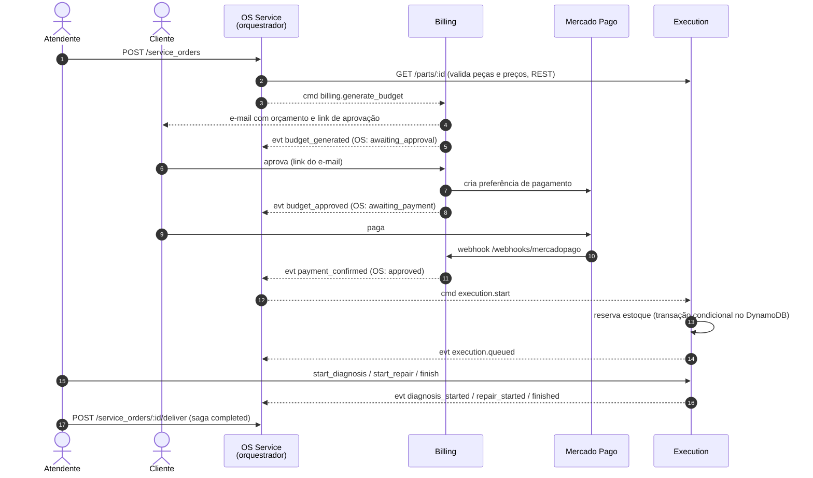
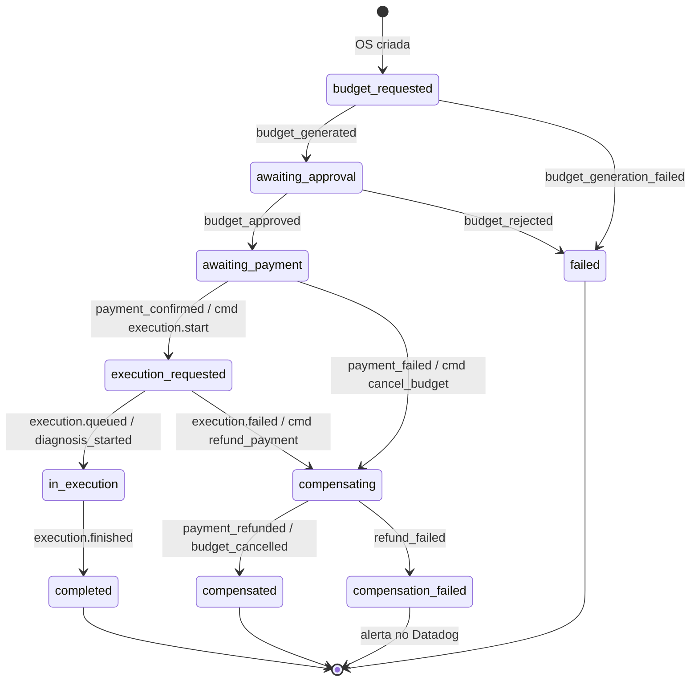

# Saga da ordem de serviço

Abrir uma OS, gerar o orçamento, receber a aprovação do cliente, cobrar e executar o
serviço passa por **três microsserviços com bancos próprios**:

- **OS Service**, em PostgreSQL;
- **Billing**, em PostgreSQL próprio;
- **Execution**, em DynamoDB.

Não existe transação distribuída entre eles. A consistência é garantida por uma
**saga orquestrada**, com uma ação de compensação para cada passo que pode precisar ser desfeito.

## Estratégia: orquestração

O **OS Service é o orquestrador**. Ele guarda o estado da saga (tabela `sagas`) e o
histórico de cada comando enviado e evento recebido (tabela `saga_steps`). Também decide
o próximo passo e, quando algo falha, qual compensação disparar. Billing e Execution são
participantes: recebem **comandos**, executam a parte deles em transação local e
respondem com **eventos**. Os participantes nunca falam entre si.

O código fica em [app/domains/service_orders/orchestration/](../../app/domains/service_orders/orchestration/):

- `ServiceOrderSaga`: máquina de estados e handlers de eventos;
- `Commands`: monta os payloads;
- `Handlers`: registro dos tipos de evento consumidos pelo worker.

### Por que orquestração e não coreografia

| Critério | Orquestração (escolhida) | Coreografia |
|---|---|---|
| Onde está o fluxo | Em um lugar só (`ServiceOrderSaga`) | Espalhado pelos três serviços |
| Compensação | O orquestrador sabe o que já foi feito e manda desfazer | Cada serviço precisa ouvir falhas dos outros e deduzir o que desfazer |
| Visibilidade | `GET /service_orders/:id/saga` mostra estado e histórico completos | Exige juntar logs de vários serviços |
| Acoplamento | Participantes só conhecem os próprios comandos e eventos | Serviços passam a depender dos eventos uns dos outros |
| Risco | O orquestrador concentra a lógica (mitigado: ele já é o dono da OS) | Ciclos de eventos difíceis de depurar |

O fluxo de uma OS é **sequencial e tem dono natural**. A OS é o agregado que o cliente
acompanha, e cada passo depende do anterior: só se cobra depois da aprovação e só se
executa depois do pagamento. Com coreografia, o Execution teria que ouvir eventos de
pagamento do Billing e o Billing teria que ouvir falhas de execução para estornar,
acoplando os dois serviços. Com orquestração, o fluxo inteiro cabe em um diagrama e em
um arquivo, e as compensações são explícitas.

## Fluxo



Setas tracejadas são mensagens assíncronas via SNS/SQS. As contínuas são HTTP.

## Estados



## Compensações

| Falha | Onde | Compensação | Resultado |
|---|---|---|---|
| Orçamento não pôde ser gerado | Billing | Nada a desfazer | OS `cancelled`, saga `failed` |
| Cliente recusa o orçamento | Billing | Nada a desfazer | OS `cancelled`, saga `failed` |
| Pagamento recusado | Mercado Pago / Billing | `billing.cancel_budget` invalida orçamento e link | OS `cancelled`, saga `compensated` |
| Execução impossível (sem estoque, peça desconhecida) | Execution | `billing.refund_payment` estorna no Mercado Pago | OS `cancelled`, saga `compensated` |
| Estorno falhou | Mercado Pago / Billing | Não há passo automático seguro | Saga `compensation_failed` e monitor no Datadog para tratamento manual |

A reserva de estoque é o **pivô** da saga. É feita numa única transação condicional
do DynamoDB (`TransactWriteItems` com `stock >= quantidade`), então ou reserva todas as
peças ou nenhuma, e não deixa estoque parcial para compensar. Depois que a execução
começa, a OS só segue em frente.

## Garantias da mensageria

- **Transactional outbox** no OS Service e no Billing: o comando ou evento é gravado na
  mesma transação da mudança de estado e publicado no SNS pelo worker. Assim não há
  mudança de estado sem mensagem nem mensagem sem mudança de estado. No Execution, a
  tabela `outbox` do DynamoDB entra na mesma `TransactWriteItems`.
- **Consumidores idempotentes**: o SNS/SQS entrega *at least once*, então cada serviço
  registra o `message_id` processado (`processed_messages`) e ignora duplicatas.
- **Ordem**: o SQS standard não garante ordem. O orquestrador valida o estado esperado
  (`guard`). Um evento que chega antes do anterior gera `OutOfOrder` e volta para a fila
  para nova tentativa. Eventos que não fazem mais sentido no estado atual são
  registrados e ignorados.
- **Falhas persistentes**: depois de 3 tentativas a mensagem vai para a DLQ do serviço,
  e um monitor no Datadog alerta.
- **Rastreabilidade**: `saga_id` = `correlation_id` em todo envelope e em todos os logs
  JSON dos três serviços. O contexto do trace do Datadog viaja no envelope, então o APM
  mostra o fluxo distribuído como um único trace.

## Como ver funcionando

```bash
# sobe os três serviços, LocalStack (SNS/SQS/DynamoDB) e Mailpit
docker compose -f docker-compose.saga.yml -p saga up -d --build
# executa o caminho feliz e a compensação de ponta a ponta
bin/saga-e2e
# histórico de uma OS
curl -H "Authorization: Bearer $TOKEN" localhost:3000/api/v1/service_orders/1/saga
```

Os mesmos cenários estão descritos em BDD em
[features/saga_ordem_de_servico.feature](../../features/saga_ordem_de_servico.feature).
